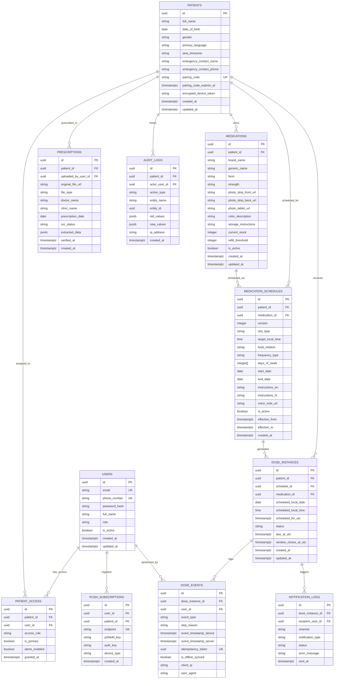

# DawaReminder — Database Architecture & ER Design

**Document Version:** 1.0.0  
**RDBMS Engine:** PostgreSQL 16  
**Primary Key Convention:** UUIDv4 (`gen_random_uuid()`)  
**Timezone Standard:** Strict UTC storage with IANA Timezone preservation  

---

## 1. Architectural Principles & Guarantees

1. **Immutable Audit Trails:** Historical dose events (`dose_events`) and system audit records (`audit_logs`) are append-only. They must never be updated or deleted (`ON DELETE RESTRICT`).
2. **Schedule Versioning:** Modifying a medication schedule never mutates previous schedule records. Instead, the active schedule version is terminated (`effective_to = NOW()`) and a new schedule row (`version = version + 1`) is created.
3. **Idempotent Confirmations:** Every dose confirmation requires a client-generated UUID `idempotency_token`. Duplicate submissions return the existing record without generating duplicate side-effects.
4. **Timezone Integrity:** All timestamp columns are defined as `TIMESTAMPTZ` (stored in UTC). Patient profiles store their canonical IANA timezone (e.g., `'Asia/Kolkata'`) to compute local calendar day boundaries accurately.

---

## 2. Complete Entity-Relationship (ER) Diagram



---

## 3. Data Dictionary & Table Specifications

### 3.1 Table: `users`
Represents family caregivers and account holders.
```sql
CREATE TABLE users (
    id UUID PRIMARY KEY DEFAULT gen_random_uuid(),
    email VARCHAR(255) UNIQUE NOT NULL,
    phone_number VARCHAR(20) UNIQUE,
    password_hash VARCHAR(255) NOT NULL,
    full_name VARCHAR(150) NOT NULL,
    role VARCHAR(50) NOT NULL DEFAULT 'CAREGIVER', -- 'ADMIN', 'CAREGIVER'
    is_active BOOLEAN NOT NULL DEFAULT TRUE,
    created_at TIMESTAMPTZ NOT NULL DEFAULT NOW(),
    updated_at TIMESTAMPTZ NOT NULL DEFAULT NOW()
);

CREATE INDEX idx_users_email ON users(email);
CREATE INDEX idx_users_phone ON users(phone_number);
```

### 3.2 Table: `patients`
Represents elderly care recipients.
```sql
CREATE TABLE patients (
    id UUID PRIMARY KEY DEFAULT gen_random_uuid(),
    full_name VARCHAR(150) NOT NULL,
    date_of_birth DATE,
    gender VARCHAR(20), -- 'MALE', 'FEMALE', 'OTHER'
    primary_language VARCHAR(10) NOT NULL DEFAULT 'hi-IN', -- 'hi-IN', 'en-IN'
    iana_timezone VARCHAR(64) NOT NULL DEFAULT 'Asia/Kolkata',
    emergency_contact_name VARCHAR(150) NOT NULL,
    emergency_contact_phone VARCHAR(20) NOT NULL,
    pairing_code VARCHAR(16) UNIQUE,
    pairing_code_expires_at TIMESTAMPTZ,
    encrypted_device_token VARCHAR(512),
    created_at TIMESTAMPTZ NOT NULL DEFAULT NOW(),
    updated_at TIMESTAMPTZ NOT NULL DEFAULT NOW()
);

CREATE INDEX idx_patients_pairing_code ON patients(pairing_code);
```

### 3.3 Table: `patient_access`
Multi-tenant authorization link between users and patients.
```sql
CREATE TABLE patient_access (
    id UUID PRIMARY KEY DEFAULT gen_random_uuid(),
    patient_id UUID NOT NULL REFERENCES patients(id) ON DELETE CASCADE,
    user_id UUID NOT NULL REFERENCES users(id) ON DELETE CASCADE,
    access_role VARCHAR(50) NOT NULL DEFAULT 'CAREGIVER', -- 'PRIMARY_OWNER', 'CAREGIVER', 'VIEWER'
    is_primary BOOLEAN NOT NULL DEFAULT FALSE,
    alerts_enabled BOOLEAN NOT NULL DEFAULT TRUE,
    granted_at TIMESTAMPTZ NOT NULL DEFAULT NOW(),
    CONSTRAINT uq_patient_user UNIQUE (patient_id, user_id)
);

CREATE INDEX idx_patient_access_user ON patient_access(user_id);
CREATE INDEX idx_patient_access_patient ON patient_access(patient_id);
```

### 3.4 Table: `medications`
The physical medication catalog.
```sql
CREATE TABLE medications (
    id UUID PRIMARY KEY DEFAULT gen_random_uuid(),
    patient_id UUID NOT NULL REFERENCES patients(id) ON DELETE CASCADE,
    brand_name VARCHAR(200) NOT NULL,
    generic_name VARCHAR(255),
    form VARCHAR(50) NOT NULL DEFAULT 'TABLET', -- 'TABLET', 'CAPSULE', 'SYRUP', 'INJECTION', 'DROPS'
    strength VARCHAR(100) NOT NULL, -- e.g. '500 mg', '40 mg'
    photo_strip_front_url VARCHAR(1024) NOT NULL,
    photo_strip_back_url VARCHAR(1024),
    photo_tablet_url VARCHAR(1024),
    color_description VARCHAR(100), -- e.g. 'Blue/White biconvex'
    storage_instructions VARCHAR(255),
    current_stock INTEGER NOT NULL DEFAULT 30,
    refill_threshold INTEGER NOT NULL DEFAULT 7,
    is_active BOOLEAN NOT NULL DEFAULT TRUE,
    created_at TIMESTAMPTZ NOT NULL DEFAULT NOW(),
    updated_at TIMESTAMPTZ NOT NULL DEFAULT NOW()
);

CREATE INDEX idx_medications_patient ON medications(patient_id) WHERE is_active = TRUE;
```

### 3.5 Table: `prescriptions`
Prescriptions uploaded by caregivers for clinical record and OCR assistance.
```sql
CREATE TABLE prescriptions (
    id UUID PRIMARY KEY DEFAULT gen_random_uuid(),
    patient_id UUID NOT NULL REFERENCES patients(id) ON DELETE CASCADE,
    uploaded_by_user_id UUID NOT NULL REFERENCES users(id) ON DELETE RESTRICT,
    original_file_url VARCHAR(1024) NOT NULL,
    file_type VARCHAR(50) NOT NULL, -- 'application/pdf', 'image/jpeg', 'image/png'
    doctor_name VARCHAR(150),
    clinic_name VARCHAR(200),
    prescription_date DATE,
    ocr_status VARCHAR(50) NOT NULL DEFAULT 'PENDING', -- 'PENDING', 'PROCESSING', 'COMPLETED', 'FAILED'
    extracted_data JSONB,
    verified_at TIMESTAMPTZ,
    created_at TIMESTAMPTZ NOT NULL DEFAULT NOW()
);

CREATE INDEX idx_prescriptions_patient ON prescriptions(patient_id);
```

### 3.6 Table: `medication_schedules`
Versioned schedules governing when medications are taken.
```sql
CREATE TABLE medication_schedules (
    id UUID PRIMARY KEY DEFAULT gen_random_uuid(),
    patient_id UUID NOT NULL REFERENCES patients(id) ON DELETE CASCADE,
    medication_id UUID NOT NULL REFERENCES medications(id) ON DELETE CASCADE,
    version INTEGER NOT NULL DEFAULT 1,
    slot_type VARCHAR(50) NOT NULL, -- 'MORNING', 'AFTERNOON', 'EVENING', 'NIGHT'
    target_local_time TIME NOT NULL, -- e.g. '08:30:00'
    food_relation VARCHAR(50) NOT NULL, -- 'BEFORE_FOOD', 'WITH_FOOD', 'AFTER_FOOD', 'EMPTY_STOMACH', 'NO_RELATION'
    frequency_type VARCHAR(50) NOT NULL DEFAULT 'DAILY', -- 'DAILY', 'DAYS_OF_WEEK', 'INTERVAL'
    days_of_week INTEGER[], -- [1,2,3,4,5,6,7] where 1 = Monday
    start_date DATE NOT NULL,
    end_date DATE,
    instructions_en TEXT,
    instructions_hi TEXT,
    voice_note_url VARCHAR(1024),
    is_active BOOLEAN NOT NULL DEFAULT TRUE,
    effective_from TIMESTAMPTZ NOT NULL DEFAULT NOW(),
    effective_to TIMESTAMPTZ,
    created_at TIMESTAMPTZ NOT NULL DEFAULT NOW(),
    CONSTRAINT uq_schedule_version UNIQUE (patient_id, medication_id, version)
);

CREATE INDEX idx_schedules_patient ON medication_schedules(patient_id) WHERE is_active = TRUE;
CREATE INDEX idx_schedules_medication ON medication_schedules(medication_id);
```

### 3.7 Table: `dose_instances`
Concrete calendar instances of a dose within a rolling 7-day window.
```sql
CREATE TABLE dose_instances (
    id UUID PRIMARY KEY DEFAULT gen_random_uuid(),
    patient_id UUID NOT NULL REFERENCES patients(id) ON DELETE CASCADE,
    schedule_id UUID NOT NULL REFERENCES medication_schedules(id) ON DELETE RESTRICT,
    medication_id UUID NOT NULL REFERENCES medications(id) ON DELETE RESTRICT,
    scheduled_local_date DATE NOT NULL,
    scheduled_local_time TIME NOT NULL,
    scheduled_for_utc TIMESTAMPTZ NOT NULL,
    status VARCHAR(50) NOT NULL DEFAULT 'UPCOMING', -- 'UPCOMING', 'DUE', 'TAKEN', 'SKIPPED', 'UNCONFIRMED', 'CANCELLED'
    due_at_utc TIMESTAMPTZ NOT NULL,
    window_closes_at_utc TIMESTAMPTZ NOT NULL,
    created_at TIMESTAMPTZ NOT NULL DEFAULT NOW(),
    updated_at TIMESTAMPTZ NOT NULL DEFAULT NOW(),
    CONSTRAINT uq_dose_instance UNIQUE (schedule_id, patient_id, scheduled_for_utc)
);

CREATE INDEX idx_dose_instances_patient_date ON dose_instances(patient_id, scheduled_local_date);
CREATE INDEX idx_dose_instances_status ON dose_instances(status, scheduled_for_utc);
```

### 3.8 Table: `dose_events`
Append-only log of patient and caregiver actions on dose instances.
```sql
CREATE TABLE dose_events (
    id UUID PRIMARY KEY DEFAULT gen_random_uuid(),
    dose_instance_id UUID NOT NULL REFERENCES dose_instances(id) ON DELETE RESTRICT,
    user_id UUID REFERENCES users(id) ON DELETE SET NULL, -- NULL if logged directly by paired elderly device
    event_type VARCHAR(50) NOT NULL, -- 'MARKED_TAKEN', 'MARKED_SKIPPED', 'CORRECTED', 'CANCELLED'
    skip_reason VARCHAR(100), -- 'FEELING_UNWELL', 'OUT_OF_STOCK', 'DOCTOR_PAUSED', 'MISTAKE'
    event_timestamp_device TIMESTAMPTZ NOT NULL,
    event_timestamp_server TIMESTAMPTZ NOT NULL DEFAULT NOW(),
    idempotency_token UUID UNIQUE NOT NULL,
    is_offline_synced BOOLEAN NOT NULL DEFAULT FALSE,
    client_ip VARCHAR(45),
    user_agent TEXT
);

CREATE INDEX idx_dose_events_instance ON dose_events(dose_instance_id);
CREATE INDEX idx_dose_events_idempotency ON dose_events(idempotency_token);
```

### 3.9 Table: `push_subscriptions`
Push notification credentials for Web Push / FCM.
```sql
CREATE TABLE push_subscriptions (
    id UUID PRIMARY KEY DEFAULT gen_random_uuid(),
    user_id UUID REFERENCES users(id) ON DELETE CASCADE,
    patient_id UUID REFERENCES patients(id) ON DELETE CASCADE,
    endpoint TEXT UNIQUE NOT NULL,
    p256dh_key TEXT NOT NULL,
    auth_key TEXT NOT NULL,
    device_type VARCHAR(50) NOT NULL, -- 'MOBILE_PWA', 'DESKTOP_CHROME', 'FIREFOX'
    created_at TIMESTAMPTZ NOT NULL DEFAULT NOW()
);

CREATE INDEX idx_push_user ON push_subscriptions(user_id);
CREATE INDEX idx_push_patient ON push_subscriptions(patient_id);
```

### 3.10 Table: `notification_logs`
Delivery audit log for alerts and escalation.
```sql
CREATE TABLE notification_logs (
    id UUID PRIMARY KEY DEFAULT gen_random_uuid(),
    dose_instance_id UUID REFERENCES dose_instances(id) ON DELETE SET NULL,
    recipient_user_id UUID NOT NULL REFERENCES users(id) ON DELETE CASCADE,
    channel VARCHAR(50) NOT NULL, -- 'WEB_PUSH', 'SMS', 'WHATSAPP'
    notification_type VARCHAR(50) NOT NULL, -- 'DOSE_DUE', 'DOSE_OVERDUE', 'REFILL_ALERT'
    status VARCHAR(50) NOT NULL, -- 'SENT', 'FAILED', 'DELIVERED'
    error_message TEXT,
    sent_at TIMESTAMPTZ NOT NULL DEFAULT NOW()
);

CREATE INDEX idx_notification_logs_recipient ON notification_logs(recipient_user_id);
```

### 3.11 Table: `audit_logs`
Legal compliance and security event ledger.
```sql
CREATE TABLE audit_logs (
    id UUID PRIMARY KEY DEFAULT gen_random_uuid(),
    patient_id UUID REFERENCES patients(id) ON DELETE CASCADE,
    actor_user_id UUID REFERENCES users(id) ON DELETE SET NULL,
    action_type VARCHAR(100) NOT NULL, -- 'SCHEDULE_UPDATE', 'PATIENT_PAIRING', 'DATA_EXPORT', 'MED_DELETED'
    entity_name VARCHAR(100) NOT NULL,
    entity_id UUID NOT NULL,
    old_values JSONB,
    new_values JSONB,
    ip_address VARCHAR(45),
    created_at TIMESTAMPTZ NOT NULL DEFAULT NOW()
);

CREATE INDEX idx_audit_patient ON audit_logs(patient_id);
```
