# DawaReminder — Development Roadmap & Hackathon Milestones

**Document Version:** 1.0.0  
**Project Horizon:** Hackathon Sprint (36-48 Hours) + Production Roadmap (90 Days)  
**Execution Methodology:** Contract-First, Trunk-Based Git Flow, Parallel Workstreams  

---

## 1. Feature Priority Matrix: P0 vs. P1 vs. P2

```
+----------------------------------------------------------------------------------+
| P0: CORE MVP (Hours 0 - 24) — MUST WORK FLAWLESSLY FOR JURY DEMO                 |
| - Caregiver Auth (Register/Login) & Patient Profile Creation                     |
| - Medicine Catalog (Add Medicine + Photo Upload for Blister Strip)               |
| - Schedule Configuration (Morning, Afternoon, Evening, Night + Food Relation)   |
| - Patient Mobile PWA Home Screen with Real Medicine Photos                       |
| - One-Tap "TAKEN" & "SKIPPED" Dose Confirmation with Haptic Feedback             |
| - Offline Mode (PWA loads without Wi-Fi; records dose to IndexedDB)              |
| - Background Sync (Replays queued doses when online; updates Caregiver view)     |
| - Caregiver Live Dose Feed (Real-time adherence status)                          |
+----------------------------------------------------------------------------------+
                                        |
+---------------------------------------v------------------------------------------+
| P1: DIFFERENTIATORS (Hours 24 - 36) — COMPETITION WINNING FEATURES               |
| - Dual Language Support (Hindi / English with 1-tap language switch)             |
| - Web Speech API Voice Instructions in Hindi ("नाश्ते के बाद यह नीली गोली लें") |
| - Prescription Ingestion Assist (PaddleOCR/OpenCV with Human Verification UI)    |
| - Overdue Escalation Web Push Alerts to Caregiver (Dose missed by 45 mins)      |
| - 7-Day Adherence Percentage Circular Ring & Daily History Breakdown             |
| - Multi-Caregiver Access (Primary Daughter + Local Nephew)                       |
+----------------------------------------------------------------------------------+
                                        |
+---------------------------------------v------------------------------------------+
| P2: POST-HACKATHON COMMERCIALIZATION (Day 30 - 90)                               |
| - Multi-regional languages (Tamil, Telugu, Bengali, Marathi, Gujarati)           |
| - WhatsApp Business API interactive buttons for non-app caregivers               |
| - Automated Pharmacy Refill integration (1mg / Netmeds / Apollo API)             |
| - BLE Smart Pillbox hardware integration                                         |
| - Ayushman Bharat Digital Mission (ABDM) Health Locker M1/M2/M3 compliance       |
+----------------------------------------------------------------------------------+
```

---

## 2. 48-Hour Hackathon Execution Timeline (Six-Member Team)

```mermaid
gantt
    title 48-Hour Hackathon Sprint Plan
    dateFormat X
    axisFormat Hour %H

    section Alignment & Setup
    Contract Freezing & DB Schema  :done, 0, 4
    Docker & Mock API Setup        :done, 2, 6

    section Frontend Workstreams
    Patient PWA Shell & Cards (Dev 3)       :active, 4, 18
    Family Dashboard CRUD & Schedules (Dev 2):active, 4, 20
    Hindi & Speech Synthesis (Dev 3)        : 18, 28
    Adherence Analytics & OCR UI (Dev 2)    : 20, 32

    section Backend & Core Services
    FastAPI Auth, Patient & Meds API (Dev 4):active, 4, 16
    Schedules & Rolling Dose Engine (Dev 5) :active, 6, 22
    Prescription Upload & PaddleOCR (Dev 5) : 16, 30
    Push Notifications & Beat Scheduler (Dev 5): 22, 34

    section QA & Integration
    E2E Integration & Offline Sync (Dev 6)  : 16, 36
    Jury Demo Dry Run & Edge Case Polish (All): 36, 44
    Code Freeze & Slide Deck Prep (Dev 1)   : 42, 48
```



---

## 3. Hour-by-Hour Sprint Breakdown

### Hours 00:00 — 04:00 | Architecture & Contract Freezing
- **All Team Members:** Review `docs/PRD.md`, `docs/API_SPECIFICATION.md`, and `docs/DATABASE_DESIGN.md`.
- **Dev 6 (DevOps):** Initialize Git monorepo, docker-compose, and launch mock API server (Prism or FastAPI mock stubs) so frontends can build immediately without waiting for database completion.
- **Dev 4 (Backend):** Initialize PostgreSQL, Alembic migrations, and SQLAlchemy models.

### Hours 04:00 — 16:00 | Parallel Core Feature Development
- **Dev 2 (Family UI):** Build Caregiver Dashboard: Login, Add Patient, Add Medicine with Image Upload modal, Schedule Editor.
- **Dev 3 (Patient UI):** Build Patient PWA: Single-day time-slotted feed, Signature Medicine Card, one-tap Taken button with haptics.
- **Dev 4 (Backend):** Implement `/auth`, `/patients`, `/medications`, and `/schedules` endpoints.
- **Dev 5 (Engine & OCR):** Implement rolling 7-day dose instance generator, Redis task queue, and basic OCR extraction pipeline.
- **Dev 6 (DevOps & QA):** Setup Nginx SSL proxy, MinIO S3 object store, and write automated API test fixtures.

### Hours 16:00 — 28:00 | Offline Engine & P1 Differentiators
- **Dev 3 (Patient UI):** Implement IndexedDB storage (`idb`), Workbox Service Worker caching, and Web Speech API Hindi voice playback.
- **Dev 2 (Family UI):** Build Split-Screen OCR Verification UI and 7-day adherence circular progress charts.
- **Dev 4 (Backend):** Implement `/doses/batch-sync` endpoint with monotonic state resolution and idempotency token handling.
- **Dev 5 (Engine & OCR):** Implement Celery Beat 45-minute overdue dose escalation check and Web Push notification dispatcher.

### Hours 28:00 — 38:00 | Full-Stack Integration & Offline Stress Testing
- Connect Patient PWA to real backend.
- **Offline Drill:** Disconnect Wi-Fi on physical Android phone -> Mark 3 doses as TAKEN -> Reconnect Wi-Fi -> Confirm doses sync to PostgreSQL within 2 seconds and appear live on Caregiver Dashboard.
- OCR end-to-end verification with sample handwritten Indian doctor prescriptions.

### Hours 38:00 — 48:00 | Polish, Demo Rehearsal & Freeze
- Polish UI transitions, Hindi translations, and accessibility contrast.
- Prepare live jury demo script (2 devices: Daughter's laptop + Dadaji's phone).
- Hard code freeze at Hour 44. Record fallback demo video in case of venue Wi-Fi failure.
