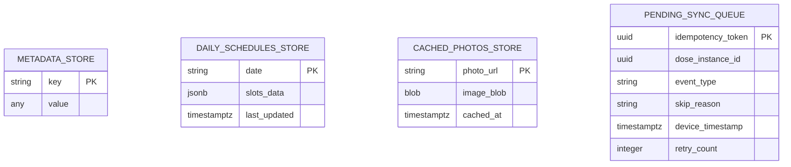

# DawaReminder — PWA & Offline Synchronization Architecture

**Document Version:** 1.0.0  
**Target Clients:** Mobile Chrome (Android 10+), Mobile Safari (iOS 16.4+), Desktop Chrome/Edge  
**Core Standard:** Progressive Web App (PWA) with Workbox 7 & IndexedDB  

---

## 1. Executive Offline Strategy

In India and developing regions, an elderly patient's mobile device frequently loses active cellular or Wi-Fi data (recharge expiry, power cuts, airplane mode, weak indoor signals). 

> **Non-Negotiable Rule:** An elderly person must **never** be prevented from seeing their medicines or marking a dose because of a network outage.

DawaReminder operates under an **Offline-First, Optimistic Local-Write Model**.

```
+------------------------------------------------------------------------------------+
|                                ELDERLY PATIENT PWA                                 |
|                                                                                    |
|  [User Interface (React Components)] <--- Reads from Local Cache & IndexedDB       |
|                 |                                                                  |
|                 v (User Taps "TAKEN")                                              |
|  [Optimistic UI Update: Soft Green Checkmark + Haptic Vibrate]                     |
|                 |                                                                  |
|                 v                                                                  |
|  [IndexedDB: Store Event in `pending_sync_queue` with UUID Token]                  |
|                 |                                                                  |
|        +--------+--------+                                                         |
|        | Is Online?      |                                                         |
|        +--------+--------+                                                         |
|           YES /   \ NO                                                             |
|              /     \                                                               |
|             v       v                                                              |
|   [POST /events]   [Register BackgroundSync / Listen for window 'online' event]     |
|         |                   |                                                      |
|         v (200 OK)          v (Connection Restored)                                |
|   [Delete Queue Item] [Replay Queue in FIFO Order -> Batch-Sync Endpoint]          |
+------------------------------------------------------------------------------------+
```

---

## 2. Web App Manifest Specification

Located at `/public/manifest.json`:
```json
{
  "name": "DawaReminder - दवाई रिमाइंडर",
  "short_name": "DawaReminder",
  "description": "बुजुर्गों के लिए आसान विजुअल दवाई रिमाइंडर ऐप / Visual medication reminder for elders",
  "start_url": "/patient",
  "scope": "/",
  "display": "standalone",
  "orientation": "portrait",
  "background_color": "#F8FAF9",
  "theme_color": "#167C53",
  "icons": [
    {
      "src": "/icons/icon-192x192.png",
      "sizes": "192x192",
      "type": "image/png",
      "purpose": "any maskable"
    },
    {
      "src": "/icons/icon-512x512.png",
      "sizes": "512x512",
      "type": "image/png",
      "purpose": "any maskable"
    }
  ]
}
```

---

## 3. Service Worker & Workbox Caching Strategy

The Service Worker uses **Workbox 7** with dedicated caching strategies tailored by asset type:

```javascript
import { precacheAndRoute } from 'workbox-precaching';
import { registerRoute } from 'workbox-routing';
import { StaleWhileRevalidate, CacheFirst, NetworkFirst } from 'workbox-strategies';
import { ExpirationPlugin } from 'workbox-expiration';
import { CacheableResponsePlugin } from 'workbox-cacheable-response';

// 1. Precache Core App Shell (HTML, JS, CSS, fonts, SVG icons)
precacheAndRoute(self.__WB_MANIFEST);

// 2. Medicine Photographs (CacheFirst - 60 day retention, max 200 images)
registerRoute(
  ({ request, url }) => url.pathname.startsWith('/meds/') || request.destination === 'image',
  new CacheFirst({
    cacheName: 'dawa-medicine-photos',
    plugins: [
      new CacheableResponsePlugin({ statuses: [0, 200] }),
      new ExpirationPlugin({
        maxEntries: 200,
        maxAgeSeconds: 60 * 24 * 60 * 60, // 60 Days
        purgeOnQuotaError: true
      })
    ]
  })
);

// 3. Daily Medication Schedule API (NetworkFirst with 2-second timeout, falling back to cache)
registerRoute(
  ({ url }) => url.pathname.includes('/doses/today'),
  new NetworkFirst({
    cacheName: 'dawa-daily-schedule-api',
    networkTimeoutSeconds: 2,
    plugins: [
      new CacheableResponsePlugin({ statuses: [200] }),
      new ExpirationPlugin({ maxAgeSeconds: 24 * 60 * 60 }) // 24 Hours
    ]
  })
);
```

---

## 4. IndexedDB Architecture (`dawareminder_offline_db`)

While HTTP cache stores assets, application state is managed in a local **IndexedDB** database (Version: `1`).

### Object Stores Structure



1. **`metadata_store`:**
   - Keys: `paired_patient_id`, `device_token`, `preferred_language`, `emergency_phone`.
2. **`daily_schedules_store`:**
   - Holds 3 days of active schedules (`yesterday`, `today`, `tomorrow`) pre-fetched whenever connectivity is active.
3. **`cached_photos_store`:**
   - Stores raw Blobs of the patient's active medicine strip images, ensuring images render instantly even in Airplane Mode.
4. **`pending_sync_queue`:**
   - Append-only transactional queue for events logged offline.

---

## 5. Offline Confirmation & Synchronization Engine

### Step-by-Step Flow

#### Phase 1: Offline Logging (At Medication Time)
1. Patient opens PWA without internet. Service Worker serves App Shell from Cache.
2. The UI reads today's doses from IndexedDB `daily_schedules_store`.
3. Patient clicks `TAKEN`.
4. The client generates an RFC 4122 v4 UUID `idempotency_token`.
5. An event object is stored in `pending_sync_queue`:
   ```json
   {
     "idempotency_token": "a57d0791-628a-4db5-b829-873b88939c81",
     "dose_instance_id": "3fa85f64-5717-4562-b3fc-2c963f66afa6",
     "event_type": "MARKED_TAKEN",
     "device_timestamp": "2026-11-22T08:35:12+05:30",
     "retry_count": 0
   }
   ```
6. The UI updates optimistically: card displays a gentle offline indicator *"सुरक्षित किया गया (Saved Offline)"*.

#### Phase 2: Reconciliation (Connectivity Restored)
1. Window listener triggers: `window.addEventListener('online', triggerSync)`.
2. Sync Manager reads all rows from `pending_sync_queue`.
3. Issues `POST /api/v1/doses/batch-sync` sending the queue items.
4. Backend applies events monotonically:
   - Verifies whether `dose_instance` is already `TAKEN`. If yes, marks as duplicate-accepted.
   - If `DUE` or `UNCONFIRMED`, transitions to `TAKEN` and records the exact `device_timestamp` alongside `server_timestamp`.
5. Upon receiving `200 OK` from backend, the client deletes the synced records from `pending_sync_queue`.
6. UI status switches to *"सब अपडेट है (All Synced)"*.

---

## 6. Conflict Resolution Model: Why NOT Last-Write-Wins (LWW)

Traditional Last-Write-Wins (LWW) causes critical bugs in healthcare apps. For instance:
- A caregiver checks in at 09:00 AM, sees the dose unconfirmed, and marks it "SKIPPED".
- Meanwhile, Dadaji took the medicine offline at 08:30 AM without connection.
- If LWW used server write time, Dadaji's genuine 08:30 AM dose would be overridden by the caregiver's later action.

### DawaReminder Monotonic State Resolution Table

| Existing Server State | Incoming Synced Event | Resolved Server State | Action / Audit Entry |
|---|---|---|---|
| `UPCOMING` or `DUE` | `MARKED_TAKEN` | `TAKEN` | Transition to Taken. Cancel overdue escalations. |
| `UNCONFIRMED` | `MARKED_TAKEN` | `TAKEN` | Transition to Taken. Caregiver alerted: "Dose confirmed retroactively". |
| `SKIPPED` (Caregiver) | `MARKED_TAKEN` (Elder) | `TAKEN` | Patient physical action supersedes caregiver assumption. Audit log recorded. |
| `TAKEN` | `MARKED_TAKEN` | `TAKEN` (No-op) | Idempotent duplicate. No mutation, return 200 OK. |
| `TAKEN` | `MARKED_SKIPPED` | `TAKEN` | Rejected. A dose reported taken cannot be un-taken without explicit Caregiver "Correction" action. |

---

## 7. Reality of PWA Limitations: Android vs. iOS

We must never promise theoretical features that break on actual physical smartphones.

### Android (Chrome)
- **Background Sync:** Supported via `registration.sync.register('sync-doses')`.
- **Storage Persistence:** High reliability. `navigator.storage.persist()` grants non-evictable storage.
- **Push Notifications:** Fully supported via Web Push (FCM).

### iOS / iPadOS (Safari & PWA)
- **Background Execution:** **NOT guaranteed.** iOS suspends WebKit tabs immediately when backgrounded. Periodic Background Sync is unsupported.
- **Push Notifications:** Only supported if the user has explicitly added the app to their Home Screen (`standalone` mode) on iOS 16.4+.
- **7-Day Storage Purge:** If a website in Safari is not visited for 7 days, its IndexedDB cache may be purged.
- **DawaReminder Countermeasure:**
  1. We guide the caregiver during pairing to tap "Add to Home Screen" on iOS devices.
  2. The PWA checks IndexedDB integrity upon every foreground launch and re-fetches the latest 7-day schedule immediately.
  3. We never rely on background timers on iOS; all reconciliation is triggered immediately upon app resume (`visibilitychange`).
