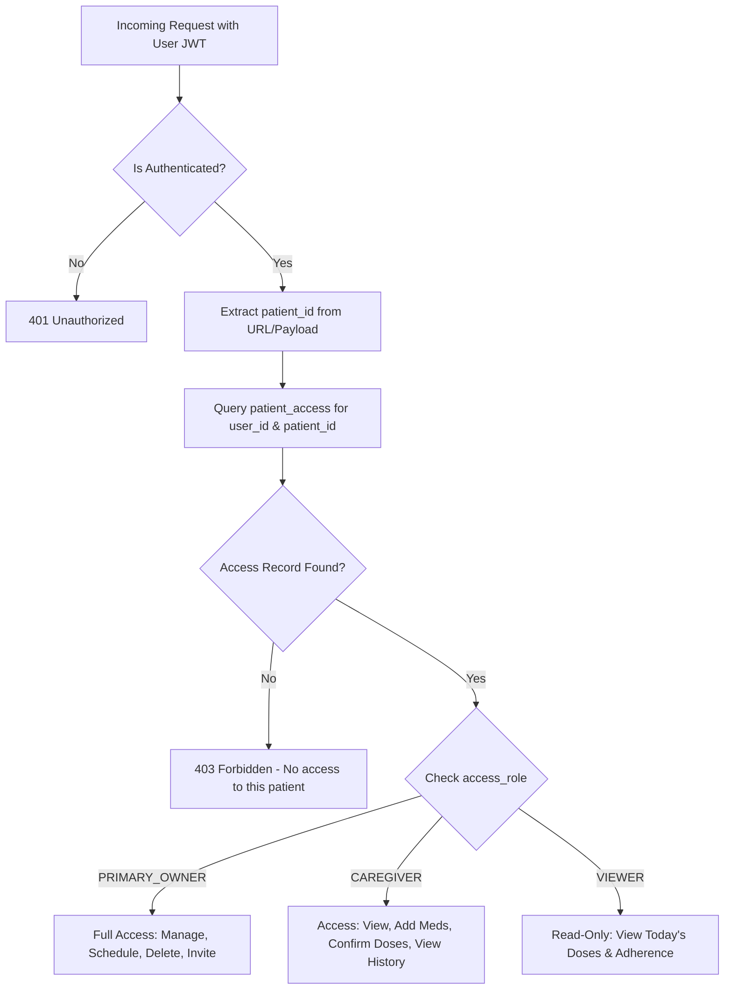

# DawaReminder — Security, Privacy & Compliance Architecture

**Document Version:** 1.0.0  
**Regulatory Standard:** Digital Personal Data Protection Act (DPDP), 2023 (India)  
**Security Tier:** Sensitive Personal Data (Health & Medical Records)  
**Encryption Standard:** AES-256-GCM (At Rest) / TLS 1.3 (In Transit)  

---

## 1. Threat Modeling & Security Principles

Medication records and medical prescriptions are classified as **Sensitive Personal Data**. Breaches can expose vulnerable elderly citizens to targeted pharmaceutical fraud, medical identity theft, and extortion.

### Key Threats & Mitigations

| Threat Vector | Potential Impact | Architecture Mitigation |
|---|---|---|
| **Unauthorized Patient Access** | Stranger manipulates medicine schedule or views medical conditions. | Cryptographically strong pairing codes (6-8 chars with high entropy, 15-minute expiry). Device tokens signed with HMAC-SHA256 and pinned to device fingerprint. |
| **Prescription S3 URL Leakage** | Confidential doctor prescriptions exposed to public web crawlers. | S3 buckets are completely private (`BlockPublicAcls = true`). Access granted solely via time-limited (10-minute) presigned URLs generated server-side after checking `patient_access`. |
| **Credential Stuffing / Brute Force** | Caregiver account compromised via dictionary attacks. | Argon2id password hashing with high memory cost ($m=65536, t=3, p=4$). Account lockout and IP rate-limiting enforced at Nginx layer (5 attempts/min on `/auth/login`). |
| **Cross-Site Scripting (XSS)** | Malicious script steals authentication tokens. | Caregiver tokens stored in `HttpOnly`, `Secure`, `SameSite=Strict` cookies. Elderly PWA device tokens stored in sandboxed IndexedDB; strict Content Security Policy (CSP). |
| **Cross-Site Request Forgery (CSRF)**| Attacker tricks caregiver into updating medication schedule. | Double-submit CSRF cookie token required for all state-changing HTTP methods (`POST`, `PUT`, `PATCH`, `DELETE`). |

---

## 2. Authentication & Authorization Architecture

### 2.1 Caregiver Authentication Flow (Argon2id + JWT)
1. Passwords hashed using **Argon2id** (`passlib[argon2]`).
2. Upon successful login, FastAPI signs a JWT containing `sub` (User UUID), `role`, and `exp` (7 days).
3. The JWT is transmitted in a `Set-Cookie` header:
   ```http
   Set-Cookie: dawa_session=eyJhbGciOi...; Path=/; Secure; HttpOnly; SameSite=Strict; Max-Age=604800
   ```
4. Session revocation: Logging out adds the JWT `jti` to Redis blacklist until expiration.

### 2.2 Elderly Patient Zero-Password Pairing Flow
1. Caregiver generates an 8-character pairing code in Dashboard (e.g. `DAWA-7281`).
2. Code is valid for 15 minutes and stored in `patients.pairing_code` with `pairing_code_expires_at`.
3. Elderly PWA scans QR or enters code.
4. Backend verifies code, generates a long-lived cryptographically signed `device_token`, associates it with `patient_id`, and nullifies the pairing code.
5. Elderly PWA stores `device_token` in local IndexedDB. All subsequent requests include header:
   ```http
   X-Patient-Device-Token: <token>
   ```
6. Backend middleware verifies device token against patient record; grants access *only* to that specific patient's daily medication records.

### 2.3 Multi-Tenant Patient-Level Authorization Matrix

Every backend request verifies user permission against `patient_access`:



---

## 3. Compliance with India DPDP Act 2023

Under the **Digital Personal Data Protection Act (2023)**:
1. **Data Fiduciary:** DawaReminder platform operator.
2. **Data Principal:** The patient (represented by authorized caregiver/legal guardian).
3. **Explicit Consent & Notice:** During onboarding, caregiver explicitly accepts processing of health records for adherence tracking.
4. **Purpose Limitation:** Prescription images and dose logs are used solely for medication tracking and adherence alerts; never sold or monetized.
5. **Right to Access & Data Portability:** Caregiver can trigger `/api/v1/patients/{id}/export` to download a complete ZIP archive containing:
   - All prescription files.
   - All medication photographs.
   - Complete historical dose ledger in CSV and JSON formats.
6. **Right to Erasure (Right to be Forgotten):** Deleting a patient profile triggers a cascade:
   - Database records soft-deleted, then hard-purged after 30 days.
   - S3 objects (prescriptions, photographs) queued for permanent deletion via lifecycle rule.
7. **Grievance Redressal Mechanism:** Clear in-app contact for Data Protection Officer (DPO) required under Indian law.

---

## 4. Secure File Upload & Storage Pipeline

Prescription images and medicine photos must never be uploaded directly to application disk space.

```
+-----------------------------------------------------------------------------------+
| 1. Client requests upload:                                                        |
|    POST /api/v1/prescriptions/upload-request { file_name: "rx.jpg", mime: "image/jpeg"|
+-----------------------------------------------------------------------------------+
                                         |
                                         v
+-----------------------------------------------------------------------------------+
| 2. Backend validates MIME type, file size (< 10MB), and caregiver permissions.    |
|    Generates S3 Presigned PUT URL (Expires in 10 minutes)                         |
|    URL Path: s3://dawa-private-vault/patients/{patient_id}/rx/{uuid}.jpg          |
+-----------------------------------------------------------------------------------+
                                         |
                                         v
+-----------------------------------------------------------------------------------+
| 3. Client uploads directly to S3 via HTTP PUT (zero server RAM burden)            |
+-----------------------------------------------------------------------------------+
                                         |
                                         v
+-----------------------------------------------------------------------------------+
| 4. Client notifies Backend: POST /api/v1/prescriptions/{id}/process-ocr           |
+-----------------------------------------------------------------------------------+
```
