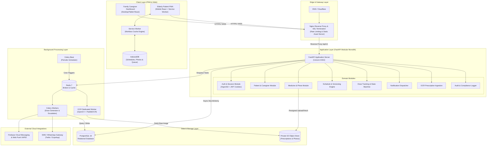
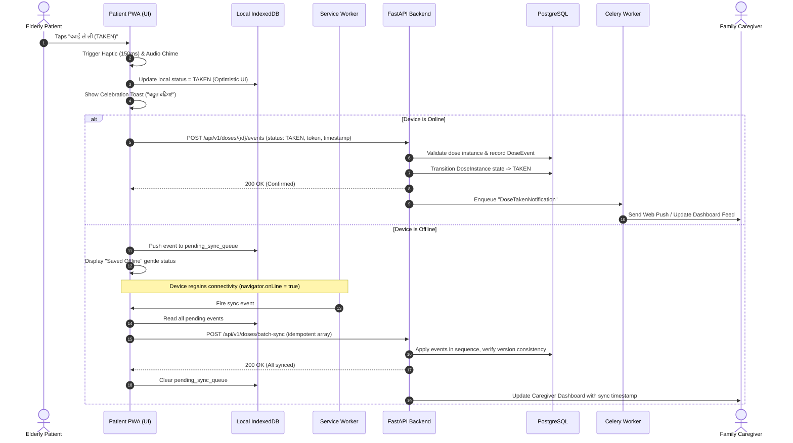
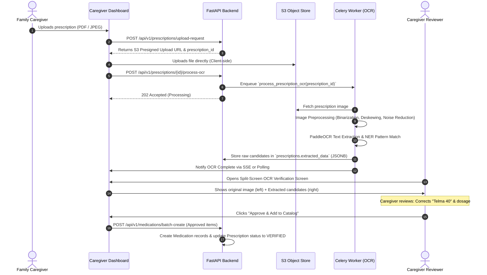

# DawaReminder — System Architecture Document

**Document Version:** 1.0.0  
**Architectural Style:** Modular Monolith with Event-Driven Background Processing  
**Deployment Model:** Containerized (Docker Compose / Cloud Container Service)  

---

## 1. Architectural Strategy & Technology Rationale

DawaReminder adopts a **Modular Monolith** architecture instead of microservices. 

### Why Modular Monolith?
1. **Team Size & Velocity:** For a six-member engineering team working on an ambitious timeline, microservices introduce severe overhead (distributed transactions, network latency, multiple CI/CD pipelines, complex observability).
2. **Transactional Consistency:** Critical clinical adherence workflows—such as updating a medication schedule while archiving obsolete future dose instances—require ACID transactions across database tables.
3. **Operational Simplicity:** A single backend codebase with strict domain module boundaries (`auth`, `patients`, `medications`, `schedules`, `doses`, `notifications`, `ocr`) can be developed, tested, and deployed as a cohesive unit while remaining trivial to split into separate services in the future if scale warrants.

### Technology Stack Justification

| Layer | Chosen Technology | Engineering Rationale |
|---|---|---|
| **Frontend Framework** | **React 18 + Vite** | Instant HMR development speed, small bundle footprint, unmatched ecosystem for accessible UI components. |
| **Styling** | **Tailwind CSS** | Atomic utility styling allows strict adherence to design system tokens without CSS bloat; critical for PWA performance. |
| **PWA Engine** | **Workbox + Service Worker** | Industry standard for reliable offline asset caching and background synchronization strategies. |
| **Local Storage** | **IndexedDB (via `idb`)** | Transactional, structured client-side storage capable of holding multi-day schedules, base64 cached pill images, and offline dose event queues. |
| **Backend Framework**| **Python 3.11 + FastAPI** | High-performance asynchronous execution (Starlette/Uvicorn), automatic OpenAPI documentation, and native Pydantic v2 validation. |
| **ORM / Data Access**| **SQLAlchemy 2.0 (Async) + Alembic** | Modern async-await support, robust transaction management, complex queries, and enterprise-grade migrations. |
| **Primary Database** | **PostgreSQL 16** | Robust relational model, JSONB support for schedule rules, UUID primary keys, and ACID compliance for audit trails. |
| **Background Broker**| **Redis 7** | Sub-millisecond queue broker for Celery and high-speed in-memory cache for patient session tokens and rate limiting. |
| **Task Queue** | **Celery 5 + Celery Beat** | Battle-tested distributed task queue for recurring schedule generators, 45-minute overdue escalation monitors, and OCR ingestion. |
| **Object Storage** | **S3-Compatible (MinIO / AWS S3)** | Secure private object storage with presigned time-limited URLs for confidential prescription PDFs and medicine photos. |
| **OCR Engine** | **PaddleOCR / OpenCV** | High accuracy multilingual OCR with lightweight model footprints compared to heavy legacy tools. |

---

## 2. High-Level Architecture Diagram

---

## 3. Data Flow Scenarios

### 3.1 Scenario A: Medicine Dose Confirmation Flow (Online & Offline)

---

### 3.2 Scenario B: Prescription OCR Extraction & Human Verification Flow

---

## 4. Background Processing & Scheduling Architecture

### 4.1 Rolling 7-Day Window Generator
Rather than running expensive real-time calculation whenever a user opens the app, DawaReminder uses an active **Rolling Window Generation Strategy**.

- **Daily Beat Schedule (00:05 UTC):** A Celery Beat task triggers `generate_weekly_dose_instances()`.
- **Lookahead:** The worker inspects all active `MedicationSchedules`, computes instances for Day `T+7` across patient-specific timezones, and inserts corresponding records into `dose_instances`.
- **Unique Constraint Protection:** A compound PostgreSQL unique index `(schedule_id, patient_id, scheduled_for_utc)` guarantees that re-running the job is completely idempotent and will never produce duplicate doses.

### 4.2 Overdue Escalation Engine
- **Frequency:** Runs every 5 minutes (`check_overdue_doses()`).
- **Algorithm:**
  1. Queries all `dose_instances` where `status = 'DUE'` and `scheduled_for_utc < (NOW() - INTERVAL '45 MINUTES')`.
  2. For each overdue dose:
     - Check `notification_logs` to ensure an escalation has not already been fired for this dose.
     - Look up designated primary and secondary caregivers in `patient_access`.
     - Dispatch Web Push notification: *"अलर्ट: रामशंकर जी ने सुबह 08:30 बजे की ग्लाइकोमेट अभी तक नहीं ली है।"*
     - Transition dose status to `UNCONFIRMED`.
     - Log alert to `notification_logs`.
